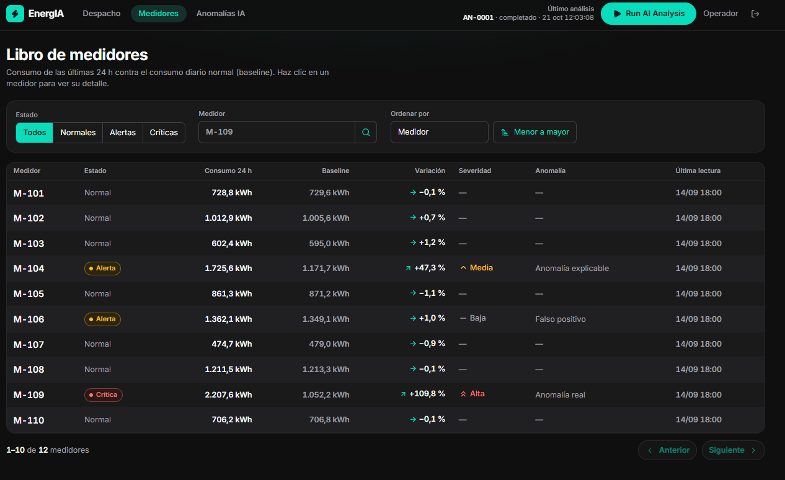
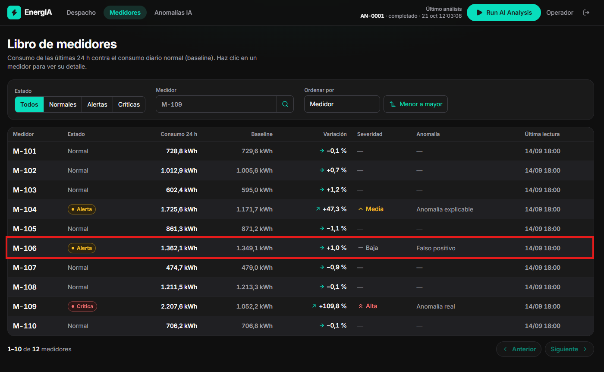
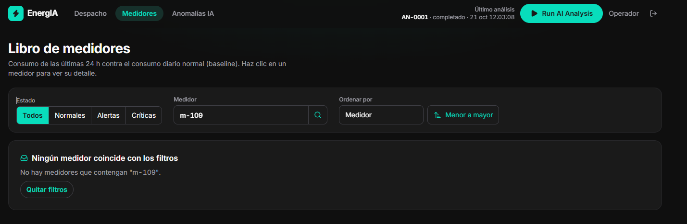
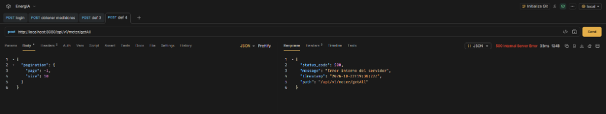

# Reporte Formal de Defectos (Bug Reports) · EnergIA

- **Autor:** Eimer Antonio Sánchez Carreño (Senior QA Automation Engineer)
- **Estándar:** IEEE 829 / ISO/IEC/IEEE 29119-3 Standard for Software Defect Reporting
- **Versión Evaluada:** `v0.1.0-mvp` (Commit base de la prueba técnica)
- **Ambiente:** Docker Compose (Frontend `:3000`, Backend API `:8080`)
- **Zona Horaria:** `America/Bogota` (COT, UTC-5)
- **Sistema Operativo:** Windows 11 Enterprise (x64)
- **Navegador:** Google Chrome 128+ / Playwright Chromium Headless

---

## Índice de Defectos Reportados

|        ID        | Título del Defecto                                                                                       |        Severidad        |        Prioridad        |  Módulo Afectado  | Causa Raíz Probable                                                      |
| :--------------: | --------------------------------------------------------------------------------------------------------- | :----------------------: | :----------------------: | :-----------------: | ------------------------------------------------------------------------- |
| **DEF-01** | Botón "Siguiente" de paginación permanentemente deshabilitado en UI bloqueando acceso a página 2       |  **High (Alta)**  |  **High (Alta)**  | `frontend/meters` | `Pagination.tsx:13` (`Math.floor` en lugar de `Math.ceil`)          |
| **DEF-02** | Medidor M-106 (Falso Positivo) catalogado como ALERT en vez de NORMAL generando falsa alarma en Dashboard |  **High (Alta)**  |  **High (Alta)**  |  `backend/meter`  | `enums.go:29-38` (`StatusOf` omite evaluar `TypeFalsePositive`)     |
| **DEF-03** | Búsqueda de medidores sensible a mayúsculas devuelve lista vacía ante consultas en minúsculas         | **Medium (Media)** | **Medium (Media)** |  `backend/meter`  | `service.go:59` (`strings.Contains` sin normalización a mayúsculas) |
| **DEF-04** | Pánico en runtime (Panic / HTTP 500) ante valor límite negativo de página en consultas paginadas         |  **High (Alta)**  | **Medium (Media)** |  `backend/httpx`  | `paging.go:24-48` (`Normalize` omite `p.Page < 1`, slice bounds out of range) |

---

## DEF-01 · Botón "Siguiente" de paginación permanentemente deshabilitado en UI bloqueando acceso a página 2

### 1. Clasificación

- **Severidad:** **High (Alta)***Justificación:* Pérdida directa de funcionalidad en interfaz de usuario. El operador queda completamente incapacitado para visualizar y acceder a los últimos 2 medidores del parque (`M-111` y `M-112`). Siendo `M-112` una anomalía crítica de calidad de datos, el impacto operativo es severo.
- **Prioridad:** **High (Alta)***Justificación:* Es un defecto visible en el flujo primario de navegación que afecta la usabilidad básica de la aplicación en el Despacho y en el Libro de Medidores.
- **Diferencia entre Severidad y Prioridad en este caso:** La severidad mide el daño funcional objetivo (imposibilidad técnica de ver filas existentes en BD/memoria); la prioridad define la urgencia de corrección para el release (debe solucionarse antes de cualquier despliegue a planta).

### 2. Pasos para Reproducir

1. Abrir el navegador e ingresar a `http://localhost:3000/login`.
2. Iniciar sesión con `admin@energia.local` / `admin123`.
3. Navegar al Libro de Medidores en `http://localhost:3000/medidores`.
4. Bajar hasta el pie de la tabla donde se ubica el control de paginación.
5. Observar el texto `"1–10 de 12 medidores"` y el estado del botón `"Siguiente"`.
6. Intentar hacer clic en el botón `"Siguiente"`.

### 3. Resultado Esperado vs. Resultado Obtenido

- **Resultado Esperado (Oráculo: `frontend/README.md`, `PRODUCT.md`):**Con 12 medidores y un tamaño de página de 10, existen 2 páginas en total. El botón "Siguiente" debe estar habilitado en la página 1. Al presionarlo, debe navegar a la URL `http://localhost:3000/medidores?pagina=2` y listar a `M-111` y `M-112`.
- **Resultado Obtenido:**
  El botón `"Siguiente"` contiene el atributo HTML `disabled`. El cursor muestra estado no permitido y no desencadena ningún evento `onClick`. El usuario no puede pasar de la página 1.

### 4. Evidencia Técnica

- **Captura de Pantalla Real:
  DEF-01 Paginación Deshabilitada**

  
- **Fragmento del DOM Renderizado:**

  ```html
  <nav aria-label="Paginación" class="flex flex-wrap items-center justify-between gap-3 pt-3">
    <p class="text-sm text-ink-muted" aria-live="polite">
      <span class="data text-ink">1–10</span> de <span class="data text-ink">12</span> medidores
    </p>
    <div class="flex gap-2">
      <button class="btn ..." disabled="">Anterior</button>
      <button class="btn ..." disabled="">Siguiente</button> <!-- ERROR: disabled en pág 1 -->
    </div>
  </nav>
  ```

### 5. Causa Raíz Probable (RCA)

- **Archivo:** `frontend/src/features/meters/components/Pagination.tsx`
- **Línea:** 13
- **Código Defectuoso:**
  ```typescript
  export function Pagination({ page, size, count, onPage }: PaginationProps) {
    const pages = Math.max(1, Math.floor(count / size)) // count=12, size=10 -> Math.floor(1.2) = 1
    // ...
    <Button onClick={() => onPage(page + 1)} disabled={page >= pages}> // 1 >= 1 es TRUE -> disabled
  ```
- **Solución Propuesta:** Cambiar `Math.floor` por `Math.ceil`:
  ```typescript
  const pages = Math.max(1, Math.ceil(count / size)) // Math.ceil(1.2) = 2 -> disabled={1 >= 2} es FALSE
  ```

### 6. Estrategia de Detección Automatizada

- Test de Playwright E2E que intente hacer clic en `page.getByRole('button', { name: /siguiente/i })` y verifique que `page.getByRole('link', { name: 'M-112' })` sea visible. El test falla hoy por elemento deshabilitado. Se marca con `test.fail()`.

---

## DEF-02 · Medidor M-106 (Falso Positivo) catalogado como ALERT en vez de NORMAL generando falsa alarma en Dashboard

### 1. Clasificación

- **Severidad:** **High (Alta)***Justificación:* Corrupción en las reglas de negocio del motor analítico. Un evento programado y cerrado que fue analizado deliberadamente como "no escalar" genera una alarma espuria en el sistema, afectando la confiabilidad de la IA y distorsionando las estadísticas de la planta.
- **Prioridad:** **High (Alta)**
  *Justificación:* El propósito fundacional de EnergIA es "evitar la fatiga de alertas". Mostrar un falso positivo como activo contradice el principio #5 del producto (*"Quiet when things are fine"*).

### 2. Pasos para Reproducir

1. Ejecutar la llamada a la API:
   ```bash
   curl -s -X POST http://localhost:8080/api/v1/meter/getAll \
     -H "Authorization: Bearer <TOKEN>" \
     -H "Content-Type: application/json" \
     -d '{"filter": {"meter_id": "M-106"}}'
   ```
2. Ejecutar la consulta del resumen de dashboard:
   ```bash
   curl -s http://localhost:8080/api/v1/dashboard/getSummary \
     -H "Authorization: Bearer <TOKEN>"
   ```
3. Abrir la interfaz web en `http://localhost:3000/` y observar el contador de KPI "Medidores" y la tarjeta de `M-106`.

### 3. Resultado Esperado vs. Resultado Obtenido

- **Resultado Esperado (Oráculo: `backend/README.md` líneas 101–108, `PRUEBA_QA.md` y comentarios en `enums.go`):**

  > *"Sin anomalía, o FALSE_POSITIVE $\rightarrow$ NORMAL"*
  >

  - Para `M-106`: `status: "NORMAL"`.
  - En `dashboard/getSummary`: `status_counts: {"normal": 9, "alert": 1, "critical": 2}` (las críticas son M-109 y M-112; la única alerta legítima es M-104 por cambio operacional activo).
  - En UI: El medidor M-106 debe mostrar sello "NORMAL".
- **Resultado Obtenido:**

  - `M-106` responde con `status: "ALERT"`.
  - En `dashboard/getSummary`: `status_counts: {"normal": 8, "alert": 2, "critical": 2}`.
  - En UI: `M-106` se visualiza con el sello ámbar de "ALERTA" y el panel de KPIs reporta "8 normales · 2 alerta · 2 críticas".

### 4. Evidencia Técnica

- **Captura de Pantalla Real:**
  DEF-02 M-106 con Alerta Espuria

  
- **Respuesta JSON de la API (`POST /meter/getAll`):**

  ```json
  {
    "page": 1,
    "size": 10,
    "count": 1,
    "rows": [
      {
        "meter_id": "M-106",
        "status": "ALERT",
        "severity": "LOW",
        "anomaly_type": "FALSE_POSITIVE",
        "priority": 4,
        "consumption_kwh": 654.1,
        "baseline_kwh": 980.5,
        "variation_pct": -33.29
      }
    ]
  }
  ```

### 5. Causa Raíz Probable (RCA)

- **Archivo:** `backend/internal/meter/enums.go`
- **Líneas:** 29–38
- **Código Defectuoso:**
  ```go
  // StatusOf traduce el resultado del motor a un estado de alerta:
  //   - sin anomalía, o falso positivo (el motor dice "no escalar"): NORMAL
  //   - severidad HIGH: CRITICAL
  //   - cualquier otra anomalía: ALERT
  func StatusOf(a *model.Anomaly) Status {
      switch {
      case a == nil:
          return StatusNormal
      case a.Severity == model.SeverityHigh:
          return StatusCritical
      default:
          return StatusAlert // ERROR: M-106 tiene a != nil y Severity == LOW, por lo que entra aquí
      }
  }
  ```
- **Solución Propuesta:**
  ```go
  func StatusOf(a *model.Anomaly) Status {
      switch {
      case a == nil || a.Type == model.TypeFalsePositive || !a.Anomaly:
          return StatusNormal
      case a.Severity == model.SeverityHigh:
          return StatusCritical
      default:
          return StatusAlert
      }
  }
  ```

### 6. Estrategia de Detección Automatizada

- Test de API en Playwright (`meters-api.spec.ts`) o test unitario en Go (`status_test.go`) que verifique:
  `expect(m106.status).toBe('NORMAL')`.

---

## DEF-03 · Búsqueda de medidores sensible a mayúsculas devuelve lista vacía ante consultas en minúsculas

### 1. Clasificación

- **Severidad:** **Medium (Media)***Justificación:* El usuario puede rodear el problema ingresando el texto en mayúsculas estrictas (`M-109`), pero infringe la especificación contractual documentada.
- **Prioridad:** **Medium (Media)**
  *Justificación:* Afecta la experiencia de búsqueda y la ergonomía del usuario.

### 2. Pasos para Reproducir

1. Ejecutar petición cURL enviando el filtro en minúsculas:
   ```bash
   curl -s -X POST http://localhost:8080/api/v1/meter/getAll \
     -H "Authorization: Bearer <TOKEN>" \
     -H "Content-Type: application/json" \
     -d '{"filter": {"meter_id": "m-109"}}'
   ```

### 3. Resultado Esperado vs. Resultado Obtenido

- **Resultado Esperado (Oráculo: `backend/README.md` línea 96 y Swagger `/docs`):**
  > *"meter_id: Búsqueda parcial, sin importar mayúsculas ('109' encuentra 'M-109')"*.
  > Debe devolver HTTP 200 con el medidor `M-109`.
  >
- **Resultado Obtenido:**
  HTTP 200 con `rows: []` y `count: 0`.

### 4. Evidencia Técnica

* **Respuesta de la UI**

  

- **Respuesta API:**
  ```json
  {
    "page": 1,
    "size": 10,
    "count": 0,
    "rows": []
  }
  ```

### 5. Causa Raíz Probable (RCA)

- **Archivo:** `backend/internal/meter/service.go` (Línea 59) y `dto.go` (Línea 44).
- **Código Defectuoso:**
  ```go
  // service.go:59
  if search != "" && !strings.Contains(sm.MeterID, search) {
      continue
  }
  ```
- **Solución Propuesta:** Normalizar ambos términos a mayúsculas:
  ```go
  if search != "" && !strings.Contains(strings.ToUpper(sm.MeterID), strings.ToUpper(search)) {
      continue
  }
  ```

### 6. Estrategia de Detección Automatizada

- Test de Playwright API enviando `meter_id: "m-109"` y esperando `body.rows.length === 1`.

---

## DEF-04 · Pánico en tiempo de ejecución (Panic / HTTP 500) ante valor límite negativo de página en consultas paginadas

### 1. Clasificación

- **Severidad:** **High (Alta)**  
  *Justificación:* Vulnerabilidad crítica de robustez en el backend. Un valor de paginación inválido (`page: -1`) genera un fallo no controlado en tiempo de ejecución en el motor de Go (`panic: runtime error: slice bounds out of range [-20:]`). El proceso aborta el handler normal y responde un código de error de infraestructura HTTP 500 Internal Server Error en lugar de rechazar limpiamente la petición.
- **Prioridad:** **Medium (Media)**  
  *Justificación:* El usuario final navegando exclusivamente desde la UI de React no produce índices de página negativos a través de los botones regulares de la interfaz; este fallo se manifiesta principalmente ante peticiones API directas, clientes automatizados o intentos de sondeo anómalo.
- **Diferencia entre Severidad y Prioridad en este caso:** La severidad mide el grado de destrucción técnica del error (un pánico irrecuperable en el corte de memoria de un slice); la prioridad determina la urgencia comercial (puede programarse su corrección en el sprint actual antes del pase a producción sin detener el trabajo de los operadores en planta).

### 2. Pasos para Reproducir

1. Obtener un token Bearer válido autenticándose en `POST /api/v1/auth/login`.
2. Enviar una petición `POST` al endpoint de medidores `http://localhost:8080/api/v1/meter/getAll` enviando un índice de página negativo en el bloque de paginación:
   ```bash
   curl -i -X POST http://localhost:8080/api/v1/meter/getAll \
     -H "Authorization: Bearer <TOKEN>" \
     -H "Content-Type: application/json" \
     -d '{"pagination": {"page": -1, "size": 10}}'
   ```
3. Observar el código de estado HTTP y el cuerpo de la respuesta devuelta por el servidor.

### 3. Resultado Esperado vs. Resultado Obtenido

- **Resultado Esperado (Estándar REST / Robustez de Software e ISO 25010):**  
  La API debe interceptar valores límite no positivos en su capa de normalización/validación. Debe responder **HTTP 400 Bad Request** indicando `"pagination.page debe ser mayor o igual a 1"` o aplicar una recuperación segura normalizando a `page = 1` y devolviendo HTTP 200. Jamás debe colapsar con error 500.
- **Resultado Obtenido:**  
  El servidor responde con código de fallo crítico **HTTP 500 Internal Server Error** con el cuerpo `{"status_code": 500, "message": "Error interno del servidor"}`. En los registros de la consola del contenedor Go se registra un pánico fatal por rebanado fuera de límites:
  `panic: runtime error: slice bounds out of range [-20:]`.

### 4. Evidencia Técnica

* **Captura de Postman en Ejecución Real:**

  

- **Respuesta API Devuelta:**
  ```json
  {
    "status_code": 500,
    "message": "Error interno del servidor",
    "timestamp": "2026-10-22T19:38:22Z",
    "path": "/api/v1/meter/getAll"
  }
  ```

### 5. Causa Raíz Probable (RCA)

- **Archivo:** `backend/internal/httpx/paging.go`
- **Líneas:** 24–35 y 48
- **Código Defectuoso:**
  ```go
  // paging.go:23-29
  func (p *Pagination) Normalize() []string {
      if p.Page == 0 {
          p.Page = DefaultPage
      }
      // OMITIDO: No existe verificación para p.Page < 0
  }

  // paging.go:48
  func Paginate[T any](items []T, p Pagination) PaginatedResult[T] {
      start := min((p.Page-1)*p.Size, len(items)) // (-1 - 1) * 10 = -20
      end := min(start+p.Size, len(items))
      return PaginatedResult[T]{
          Rows: append([]T{}, items[start:end]...), // items[-20:end] causa PANIC
      }
  }
  ```
- **Solución Propuesta:** Normalizar valores menores a 1 en `Normalize()` o agregarlo a la lista de errores de validación:
  ```go
  if p.Page < 1 {
      p.Page = DefaultPage
  }
  ```

### 6. Estrategia de Detección Automatizada

- Test automatizado de API en Playwright (`meters-api.spec.ts`) enviando `pagination: { page: -1, size: 10 }`, marcado con `test.fail()` para verificar que la API responda HTTP 400 o 200 y nunca HTTP 500.
