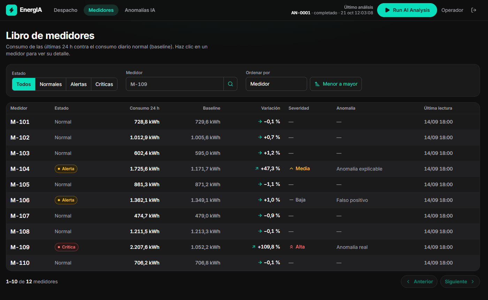
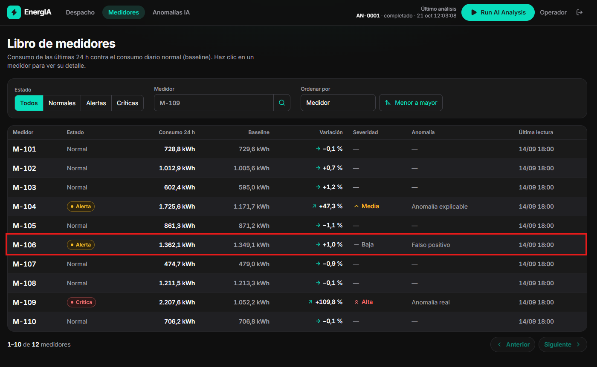
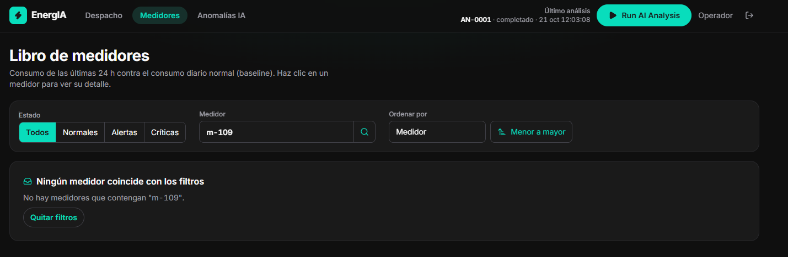

# Evidencias de Ejecución de Pruebas · EnergIA

Esta carpeta almacena las capturas de pantalla, respuestas raw HTTP de la API y registros de consola que respaldan los reportes de defectos y la ejecución de la suite de pruebas.

---

## 1. Evidencias de Defectos

### DEF-01: Paginación Rota en UI (Botón Siguiente Deshabilitado)

- **Captura PNG:**

  
- **Componente:** `Pagination.tsx`
- **Comportamiento observado:**
  En `http://localhost:3000/medidores`, habiendo 12 medidores en total y un tamaño de página de 10, el indicador de página muestra `1–10 de 12 medidores` pero el botón `Siguiente` posee el atributo `disabled=""`.
- **Cálculo erróneo:** `Math.floor(12 / 10) = 1` $\rightarrow$ `page >= pages` (`1 >= 1`) evalúa a `true`.

### DEF-02: Falso Positivo M-106 Marcado como ALERT en vez de NORMAL

- **Captura PNG:**

  
- **Endpoint:** `POST /api/v1/meter/getAll`
- **Request cURL:**

  ```bash
  curl -s -X POST http://localhost:8080/api/v1/meter/getAll \
    -H "Authorization: Bearer <TOKEN>" \
    -H "Content-Type: application/json" \
    -d '{"filter": {"meter_id": "M-106"}}'
  ```
- **Response JSON:**

  ```json
  {
    "page": 1,
    "size": 10,
    "count": 1,
    "rows": [
      {
        "meter_id": "M-106",
        "status": "ALERT",
        "severity": "LOW",
        "anomaly_type": "FALSE_POSITIVE",
        "priority": 4,
        "consumption_kwh": 654.1,
        "baseline_kwh": 980.5,
        "variation_pct": -33.29,
        "last_reading_at": "2026-09-14T23:00:00Z"
      }
    ]
  }
  ```
- **Inconsistencia:** La documentación y `PRODUCT.md` ordenan `FALSE_POSITIVE -> NORMAL`.

### DEF-03: Búsqueda Sensible a Mayúsculas en UI/API

* **Captura PNG:**

  

- **Endpoint:** `POST /api/v1/meter/getAll`
- **Request cURL:**
  ```bash
  curl -s -X POST http://localhost:8080/api/v1/meter/getAll \
    -H "Authorization: Bearer <TOKEN>" \
    -H "Content-Type: application/json" \
    -d '{"filter": {"meter_id": "m-109"}}'
  ```
- **Response JSON:**
  ```json
  {
    "page": 1,
    "size": 10,
    "count": 0,
    "rows": []
  }
  ```
- **Inconsistencia:** En Swagger y README se indica: *"Búsqueda parcial, sin importar mayúsculas ('109' encuentra 'M-109')"*.

### DEF-04: Pánico en Runtime (Panic / HTTP 500) ante Página Negativa

* **Captura de Postman en Ejecución Real:**

  

- **Endpoint:** `POST /api/v1/meter/getAll`
- **Request cURL:**
  ```bash
  curl -i -X POST http://localhost:8080/api/v1/meter/getAll \
    -H "Authorization: Bearer <TOKEN>" \
    -H "Content-Type: application/json" \
    -d '{"pagination": {"page": -1, "size": 10}}'
  ```
- **Response JSON:**
  ```json
  {
    "status_code": 500,
    "message": "Error interno del servidor",
    "timestamp": "2026-10-22T19:38:22Z",
    "path": "/api/v1/meter/getAll"
  }
  ```
- **Log de Consola Go (Runtime Panic):**
  `panic: runtime error: slice bounds out of range [-20:]`
- **Inconsistencia:** La API debe responder `HTTP 400 Bad Request` indicando que `page` debe ser mayor o igual a 1, o aplicar una normalización segura a `page = 1` devolviendo HTTP 200, pero jamás colapsar con HTTP 500.
